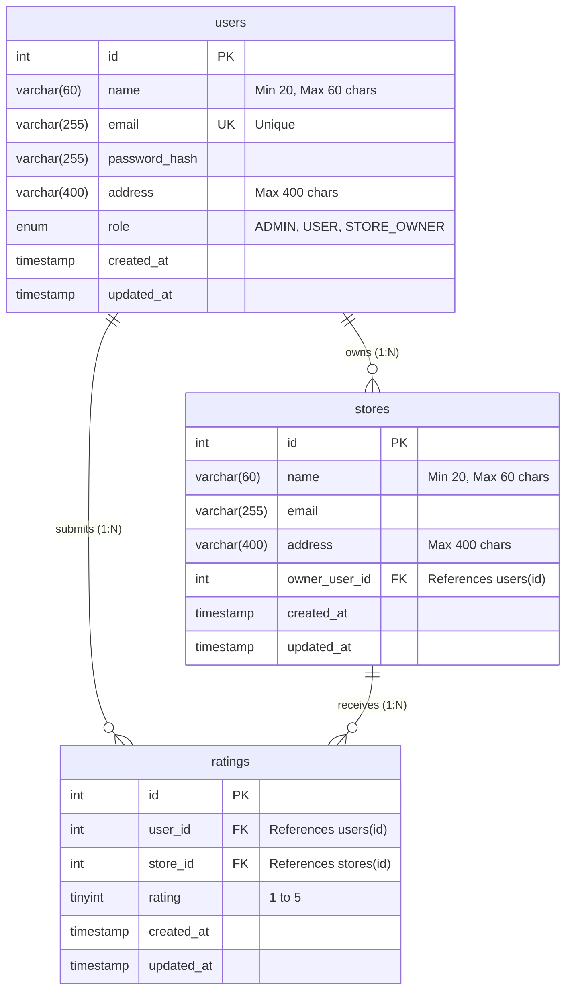

# Store Rating Web Application

A full-stack web application designed and built for the **Roxiler Systems Full Stack Intern Coding Challenge**. The system provides a centralized platform for discovering retail stores, submitting and modifying customer ratings (1–5 stars), and managing users and stores through strict role-based access control (RBAC).

---

## 🎬 Video Demo & Walkthrough

[](https://youtu.be/0qX5MBqBl2w)

> 📺 **Watch Demo on YouTube**: [https://youtu.be/0qX5MBqBl2w](https://youtu.be/0qX5MBqBl2w)

---

## ⚡ Quick Start: How to Run in 3 Minutes

### Prerequisites

- **Node.js**: v18.0.0 or higher
- **MySQL**: MySQL Server 8.0+ running locally (e.g. standard port `3306`)
- **Git** & **npm**

---

### Step 1: Install Dependencies

Open a terminal in the project root:

```bash
# Install backend dependencies
cd backend
npm install
cd ..

# Install frontend dependencies
cd frontend
npm install
cd ..
```

---

### Step 2: Configure Environment & Initialize Database

1. Create backend `.env` configuration:
   ```bash
   cp backend/.env.example backend/.env
   ```
2. Open `backend/.env` and update your MySQL credentials:

   ```env
   PORT=5000
   NODE_ENV=development
   FRONTEND_URL=http://localhost:5173

   DB_HOST=localhost
   DB_PORT=3306
   DB_USER=root
   DB_PASSWORD=your_mysql_password_here
   DB_NAME=store_rating_db

   JWT_SECRET=super_secret_jwt_key_roxiler_challenge_2026
   JWT_EXPIRES_IN=24h
   COOKIE_MAX_AGE_DAYS=1
   ```

3. Initialize the database schema and populate sample seed data:

   ```bash
   # Creates database, tables, check constraints, foreign keys, and indexes
   npm run db:init

   # Seeds realistic users, stores, and ratings with hashed passwords
   npm run db:seed
   ```

---

### Step 3: Launch the Application

Open **two terminal windows**:

#### Terminal 1 — Start Backend Server

```bash
npm run start:backend
# Server starts at http://localhost:5000
# Health check: http://localhost:5000/api/health
```

#### Terminal 2 — Start Frontend Application

```bash
npm run start:frontend
# Client starts at http://localhost:5173
```

Now open **`http://localhost:5173`** in your browser.

---

### 🔑 Pre-Configured Demo Accounts (Ready to Test)

The seed script creates ready-to-use accounts for all roles (also available via one-click **Demo Quick-Login** buttons on the login screen):

| Role                     | Email                       | Password     | Access & Capabilities                                      |
| :----------------------- | :-------------------------- | :----------- | :--------------------------------------------------------- |
| **System Administrator** | `admin@roxiler.com`         | `Admin@1234` | System dashboard, user/store management, rating audits     |
| **Store Owner**          | `alice.owner@roxiler.com`   | `Owner@1234` | Store dashboard, customer review logs, live average rating |
| **Store Owner**          | `robert.owner@roxiler.com`  | `Owner@1234` | Associated store profile and submissions                   |
| **Store Owner**          | `charles.owner@roxiler.com` | `Owner@1234` | Unassigned store owner (demonstrates clean empty state)    |
| **Normal User**          | `chris.user@gmail.com`      | `User@1234`  | Rate stores, modify ratings, browse/search listings        |
| **Normal User**          | `samantha.user@gmail.com`   | `User@1234`  | Customer account with existing reviews                     |

---

## 🌟 Key Features Highlight

### 1. 👑 System Administrator Features

- **Real-Time Database Dashboard**: Live metric cards displaying:
  - Total registered users count
  - Total registered stores count
  - Total submitted ratings count
- **User Management**:
  - View all user accounts (Name, Email, Address, Role, Creation Date).
  - Create new accounts with **ADMIN**, **USER**, or **STORE_OWNER** roles.
  - Multi-field filters: filter in real-time by **Name**, **Email**, **Address**, and **Role**.
  - **Store Owner Rating Inspection**: If a user is a Store Owner, their store's overall rating is displayed directly in the user list, and clicking **View Details** inspects their associated store details, average star rating, and total review count.
- **Store Management**:
  - View registered stores with Name, Email, Address, Assigned Store Owner, Overall Rating, and Review Count.
  - Create new stores and assign them to verified Store Owners.
  - Multi-field filters by Name, Email, and Address.
- **Interactive Sorting**: Click directly on table headers to sort ascending/descending with clear visual sort indicators.

---

### 2. 👤 Normal User Features

- **Public Registration & Unified Login**:
  - Sign up with Name, Email, Address, and Password (strictly provisioned with `USER` role).
  - Unified login automatically routes to the store discovery page.
- **Store Discovery & Search**:
  - Simultaneous search by **Store Name** and **Address**.
  - Dual view toggle: **Card Grid View** or **Sortable Data Table View**.
- **Interactive Rating System**:
  - Submit ratings between **1 and 5 stars** using an interactive star component.
  - Displays overall store rating (`AVG` computed directly in MySQL) and total review count.
  - Highlights user's previously submitted rating.
  - **Upsert Rating Logic**: Users can submit a new rating or modify an existing rating seamlessly without duplicate database rows.
- **Account Management**: Update password securely after logging in; single-click logout.

---

### 3. 🏬 Store Owner Features

- **Dedicated Store Owner Dashboard**:
  - Displays associated store profile (Name, Address, Email).
  - Real-time overall average rating score with visual star representation.
  - Total customer reviews counter.
  - Complete customer submission log table (Customer Name, Email, Star Rating, and Submission/Update Date).
- **Interactive Table Sorting**: Click table column headers to sort customer feedback by **Customer Name**, **Customer Email**, **Rating**, or **Date**.
- **Clean Empty State**: Graceful fallback UI for store owners who have not yet been assigned a store by an administrator.
- **Account Management**: Update password and log out securely.

---

### 4. 📋 Strict Form Validations & Database Integrity

The application rigorously enforces all challenge validation requirements at **both frontend and backend levels**, backed by **MySQL CHECK constraints**:

| Field         | Validation Rule                                            | Enforcement Mechanisms                                                                                            |
| :------------ | :--------------------------------------------------------- | :---------------------------------------------------------------------------------------------------------------- |
| **Full Name** | Min 20 characters, Max 60 characters                       | Frontend character counter meter, Express validator, DB `chk_users_name_length` & `chk_stores_name_length`        |
| **Address**   | Optional, Max 400 characters                               | Frontend character length counter, Express validator, DB `chk_users_address_length` & `chk_stores_address_length` |
| **Password**  | 8–16 characters, ≥1 uppercase letter, ≥1 special character | Strict Regex validation on signup, admin creation, and password modification                                      |
| **Email**     | Standard RFC-compliant email                               | Strict email regex, normalized to lowercase, DB `uk_users_email` unique constraint                                |
| **Rating**    | Integer between 1 and 5                                    | Express validator, DB constraint `chk_ratings_range`, and interactive 5-star selector                             |

---

### 5. 📊 Interactive Table Sorting Everywhere

Per the challenge requirements, **all data tables support ascending and descending sorting**:

- **Admin Users Table**: Sort by Name, Email, Address, Role, or Created Date.
- **Admin Stores Table**: Sort by Store Name, Store Email, Address, Overall Rating, or Reviews Count.
- **Store Owner Submissions Table**: Sort by Customer Name, Customer Email, Rating, or Submission Date.
- **Normal User Stores Table**: Sort by Store Name, Address, Overall Rating, or Reviews Count.

---

### 6. 🛡️ Security Best Practices

- **HttpOnly Secure Cookies**: JWT tokens are stored in `HttpOnly` cookies (`SameSite=lax`), completely immune to JavaScript XSS token theft.
- **Bcrypt Hashing**: Passwords salted and hashed with `bcryptjs` (10 rounds). Plaintext passwords are never logged or stored.
- **Role-Based Authorization (RBAC)**: Server-side middleware (`requireRoles`) protects private endpoints against unauthorized access.
- **SQL Injection Defense**: 100% parameterized SQL queries (`?` placeholders via `mysql2/promise`).
- **Brute-Force Rate Limiting**: `express-rate-limit` guards login and registration routes.
- **Ownership Scoping**: Store owners can strictly query data linked to their authenticated `user_id`.

---

## 🛠️ Technology Stack

- **Frontend**: React.js 18, React Router v6, Axios, Lucide Icons, Vite
- **Backend**: Node.js, Express.js 4, Express Rate Limit, Cookie Parser, CORS
- **Database**: MySQL 8.0+ (`mysql2/promise` with connection pooling)
- **Authentication**: JSON Web Tokens (`jsonwebtoken`) & `bcryptjs`
- **Testing**: Jest & Supertest
- **Design System**: Responsive Vanilla CSS with customized HSL color palette, dark text contrast, and micro-interactions

---

## 🗄️ Database Architecture & Schema

The application uses a normalized MySQL 8.0 relational schema:



- **Unique Constraint**: `uk_user_store_rating (user_id, store_id)` ensures a user can submit only one rating per store.
- **Foreign Keys**: `ON DELETE CASCADE` for ratings when users or stores are removed; `ON DELETE RESTRICT` for store owners to prevent orphaned stores.

---

## 🧪 Running Automated Tests

Run the backend test suite:

```bash
npm test
# Or: npm --prefix backend test
```

The test suite covers:

- Input validation (Name 20–60 chars, password complexity, email format, address limits, rating range 1–5).
- Authentication middleware and JWT cookie verification.
- Role-based authorization matrix (`requireRoles`).
- Integration tests for signup, login, store listing, rating submissions, and dashboard metrics.

---

## 📡 API Endpoints Summary

### Authentication (`/api/auth`)

| Method  | Endpoint             | Access        | Purpose                                     |
| :------ | :------------------- | :------------ | :------------------------------------------ |
| `POST`  | `/api/auth/signup`   | Public        | Register Normal User (enforces role `USER`) |
| `POST`  | `/api/auth/login`    | Public        | Unified login; sets HttpOnly cookie         |
| `POST`  | `/api/auth/logout`   | Authenticated | Clears HttpOnly cookie                      |
| `GET`   | `/api/auth/me`       | Authenticated | Returns current authenticated profile       |
| `PATCH` | `/api/auth/password` | Authenticated | Updates account password                    |

### Administrator (`/api/admin`)

| Method | Endpoint               | Access  | Purpose                                                  |
| :----- | :--------------------- | :------ | :------------------------------------------------------- |
| `GET`  | `/api/admin/dashboard` | `ADMIN` | Total counts: users, stores, submitted ratings           |
| `GET`  | `/api/admin/users`     | `ADMIN` | Filter & sort users; includes store ratings for owners   |
| `POST` | `/api/admin/users`     | `ADMIN` | Create user with `ADMIN`, `USER`, or `STORE_OWNER` role  |
| `GET`  | `/api/admin/users/:id` | `ADMIN` | Inspect user profile and associated store rating details |
| `GET`  | `/api/admin/stores`    | `ADMIN` | Filter & sort stores with average ratings                |
| `POST` | `/api/admin/stores`    | `ADMIN` | Create store and link with a Store Owner                 |

### Stores & Ratings (`/api/stores`)

| Method  | Endpoint                  | Access        | Purpose                                                        |
| :------ | :------------------------ | :------------ | :------------------------------------------------------------- |
| `GET`   | `/api/stores`             | Public / Auth | Search stores by name/address; returns average and user rating |
| `GET`   | `/api/stores/:id`         | Public / Auth | Get store details and rating breakdown                         |
| `POST`  | `/api/stores/:id/ratings` | `USER`        | Submit rating (1–5)                                            |
| `PATCH` | `/api/stores/:id/ratings` | `USER`        | Modify previously submitted rating                             |

### Store Owner (`/api/owner`)

| Method | Endpoint               | Access        | Purpose                                                 |
| :----- | :--------------------- | :------------ | :------------------------------------------------------ |
| `GET`  | `/api/owner/dashboard` | `STORE_OWNER` | Business metrics, average rating, customer reviews list |
| `GET`  | `/api/owner/ratings`   | `STORE_OWNER` | List of customer ratings with sorting                   |

---

## 📹 Video Walkthrough & Guide

- 🎥 **Watch the Full Video Walkthrough on YouTube**: [https://youtu.be/0qX5MBqBl2w](https://youtu.be/0qX5MBqBl2w)
- 📝 A step-by-step 10-phase demonstration guide for evaluating or recording a demo video is available at:  
  👉 **[docs/demo-recording-guide.md](docs/demo-recording-guide.md)**

---

## 👨‍💻 Author

**Balavignesh**  
Developed for the **Roxiler Systems Full Stack Coding Challenge**.
