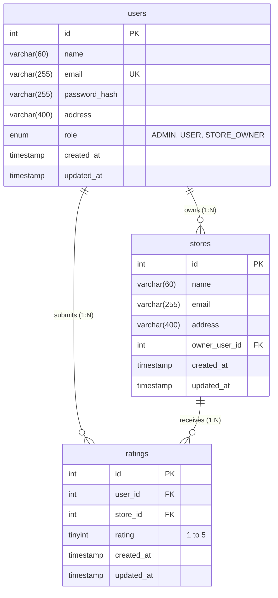

# Store Rating Web Application

A full-stack web application designed and built for the **Roxiler Systems Full Stack Intern Coding Challenge**. The system provides a centralized platform for discovering retail stores, submitting and modifying customer ratings (1–5 stars), and managing users and stores through role-based access control.

---

## Table of Contents

- [1. Project Overview](#1-project-overview)
- [2. Features by Role](#2-features-by-role)
- [3. Technology Stack](#3-technology-stack)
- [4. Application Architecture](#4-application-architecture)
- [5. Database Schema & Relationships](#5-database-schema--relationships)
- [6. Prerequisites](#6-prerequisites)
- [7. Installation & Setup (Windows)](#7-installation--setup-windows)
- [8. MySQL Database Creation & Seeding](#8-mysql-database-creation--seeding)
- [9. Environment Configuration](#9-environment-configuration)
- [10. Running the Application](#10-running-the-application)
- [11. Running Automated Tests](#11-running-automated-tests)
- [12. API Endpoint Summary](#12-api-endpoint-summary)
- [13. Security Implementation](#13-security-implementation)
- [14. Key Architectural & Design Decisions](#14-key-architectural--design-decisions)
- [15. Demonstration Video Guide](#15-demonstration-video-guide)
- [16. Known Limitations](#16-known-limitations)

---

## 1. Project Overview

The Store Rating Portal is a multi-tier web application featuring a unified authentication system with three distinct roles:
1. **System Administrator**: Manages the platform, views live system metrics, creates accounts with assigned roles, and registers new stores linked to store owners.
2. **Normal User**: Registers publicly, browses and searches stores by name or address, views database-computed aggregate ratings, and submits or updates store ratings.
3. **Store Owner**: Views dedicated business dashboards displaying store performance, average star rating, and detailed customer submission logs.

---

## 2. Features by Role

### A. System Administrator (`ADMIN`)
- **Dashboard Statistics**: Database-backed counts for registered users, stores, and submitted ratings.
- **User Management**:
  - Filter users by Name, Email, Address, and Role.
  - Sort users by Name, Email, Role, and Registration Date (Ascending/Descending).
  - Create user accounts with any role (`ADMIN`, `USER`, or `STORE_OWNER`).
  - Inspect complete user profiles, including associated store rating metrics for Store Owners.
- **Store Management**:
  - Filter stores by Name, Email, and Address.
  - Sort stores by Name, Email, Address, Average Rating, and Review Count.
  - Add new stores and associate them with a verified Store Owner.
- **Account Actions**: Update account password and securely log out.

### B. Normal User (`USER`)
- **Registration & Unified Login**: Public registration with Name (20–60 chars), Email, Address, and Password (8–16 chars, uppercase, special character). Public signup strictly provisions the `USER` role.
- **Store Discovery**: Browse stores with computed overall ratings, total review counts, and the user's previously submitted rating (if any).
- **Search & Sort**: Filter stores by Name or Address; sort by Name, Rating, or Total Reviews.
- **Rating Submission & Upsert**:
  - Rate any store from 1 to 5 stars.
  - Enforces at most one rating per user per store (`(user_id, store_id)` unique constraint).
  - Submitting another rating updates the existing record without creating duplicates.
  - Overall store rating is dynamically recalculated by the MySQL backend (`AVG(rating)`).
- **Account Actions**: Update account password and securely log out.

### C. Store Owner (`STORE_OWNER`)
- **Dedicated Dashboard**:
  - Displays the business profile, overall average rating, and total rating count.
  - Lists all customers who rated the store with customer name, email, star score, and submission timestamp.
- **Ownership Verification**: Backend ensures store owners can only access ratings for their owned store.
- **Clean Empty State**: If no store is assigned to the owner, a friendly informational empty state is rendered rather than an application failure.
- **Account Actions**: Update account password and securely log out.

---

## 3. Technology Stack

- **Frontend**: [React.js](https://react.dev/) (v18), [React Router](https://reactrouter.com/) (v6), [Axios](https://axios-http.com/)
- **Backend**: [Node.js](https://nodejs.org/) with [Express.js](https://expressjs.com/) (v4)
- **Database**: [MySQL](https://www.mysql.com/) (v8.0+)
- **Authentication**: JSON Web Tokens (`jsonwebtoken`) stored in **HttpOnly, SameSite cookies**
- **Password Security**: [bcryptjs](https://github.com/dcodeIO/bcrypt.js) (10 salt rounds)
- **Styling**: Clean, responsive modern CSS (`Inter` typography, CSS variables, mobile-first flex/grid)
- **Rate Limiting**: `express-rate-limit` for authentication endpoints
- **Testing**: [Jest](https://jestjs.io/) and [Supertest](https://github.com/ladjs/supertest)

---

## 4. Application Architecture

```
store-rating/
├── package.json               # Root scripts (run both backend & frontend)
├── .gitignore                 # Excludes secrets, node_modules, and build outputs
├── database/
│   ├── schema.sql             # Reproducible DDL schema (tables, foreign keys, CHECK constraints)
│   └── seed.sql               # Optional sample SQL dataset
├── docs/
│   └── demo-recording-guide.md# Complete 10-step video demonstration walkthrough
├── backend/
│   ├── .env.example           # Example backend environment variables
│   ├── package.json           # Backend dependencies and scripts
│   ├── src/
│   │   ├── server.js          # HTTP server listener and DB connectivity check
│   │   ├── app.js             # Express app setup, CORS, cookies, route mounting
│   │   ├── config/            # Centralized environment and MySQL connection pool
│   │   ├── controllers/       # Business logic (auth, admin, store, owner)
│   │   ├── routes/            # Route declarations with middleware protection
│   │   ├── middleware/        # Authentication, RBAC, error handling
│   │   ├── validators/        # Input validation rules (Name 20-60, Passwords, etc.)
│   │   ├── utils/             # Token signing, verification, cookie helpers
│   │   └── scripts/           # initDb.js and seedDb.js Node scripts
│   └── tests/                 # Automated unit and integration tests
└── frontend/
    ├── package.json           # Frontend dependencies and Vite configuration
    ├── vite.config.js         # Vite configuration with API proxying
    ├── index.html             # HTML entrypoint
    └── src/
        ├── App.jsx            # Top-level routing and role protection
        ├── main.jsx           # React DOM root render
        ├── context/           # AuthContext for user session management
        ├── services/          # Axios API service module
        ├── components/        # Reusable UI (Navbar, StarRating, Modal, Alert, etc.)
        ├── pages/             # Role-specific screens (Admin, User, Owner, Auth)
        └── styles/            # Responsive CSS stylesheet
```

---

## 5. Database Schema & Relationships

The database `store_rating_db` uses normalized relational modeling across three core tables:



### Table Details & Constraints
1. **`users` Table**:
   - `id`: `INT AUTO_INCREMENT PRIMARY KEY`
   - `name`: `VARCHAR(60) NOT NULL`, with `CHECK (CHAR_LENGTH(name) >= 20 AND CHAR_LENGTH(name) <= 60)`
   - `email`: `VARCHAR(255) NOT NULL UNIQUE`
   - `password_hash`: `VARCHAR(255) NOT NULL` (stored as bcrypt hash, never plaintext)
   - `address`: `VARCHAR(400) NULL`
   - `role`: `ENUM('ADMIN', 'USER', 'STORE_OWNER') NOT NULL DEFAULT 'USER'`
2. **`stores` Table**:
   - `id`: `INT AUTO_INCREMENT PRIMARY KEY`
   - `name`: `VARCHAR(60) NOT NULL`, with `CHECK (CHAR_LENGTH(name) >= 20 AND CHAR_LENGTH(name) <= 60)`
   - `email`: `VARCHAR(255) NOT NULL`
   - `address`: `VARCHAR(400) NULL`
   - `owner_user_id`: `INT NOT NULL`, foreign key referencing `users(id)` `ON DELETE RESTRICT ON UPDATE CASCADE`
3. **`ratings` Table**:
   - `id`: `INT AUTO_INCREMENT PRIMARY KEY`
   - `user_id`: `INT NOT NULL`, foreign key referencing `users(id)` `ON DELETE CASCADE`
   - `store_id`: `INT NOT NULL`, foreign key referencing `stores(id)` `ON DELETE CASCADE`
   - `rating`: `TINYINT NOT NULL`, with `CHECK (rating >= 1 AND rating <= 5)`
   - **Unique Constraint**: `UNIQUE KEY uk_user_store_rating (user_id, store_id)` guarantees each user can have at most one rating per store.

---

## 6. Prerequisites

- **Operating System**: Windows 10/11
- **Node.js**: v18.0.0 or higher (v26.4.0 verified)
- **npm**: v9.0.0 or higher
- **MySQL**: MySQL Server 8.0 or higher (service `MySQL80` running)

---

## 7. Installation & Setup (Windows)

Clone the repository or navigate to the project directory:

```powershell
# Navigate to project folder
cd "c:\Users\Balavignesh\Desktop\store rating"

# Install backend dependencies
cd backend
npm install
cd ..

# Install frontend dependencies
cd frontend
npm install
cd ..
```

---

## 8. MySQL Database Creation & Seeding

### Step A: Configure Local Credentials
Copy the example environment file in `backend`:
```powershell
cp backend/.env.example backend/.env
```
Open `backend/.env` in Visual Studio Code and enter your MySQL root password:
```env
DB_HOST=localhost
DB_PORT=3306
DB_USER=root
DB_PASSWORD=your_mysql_root_password_here
DB_NAME=store_rating_db
```

### Step B: Run Automated Database Initialization
Execute the database initialization script:
```powershell
npm run db:init
```
*What this does*: Connects to MySQL, executes `database/schema.sql`, creates the `store_rating_db` database, tables, foreign keys, and indexes.

### Step C: Populate Seed Test Data
Populate realistic development accounts and stores:
```powershell
npm run db:seed
```

#### Pre-configured Test Accounts:
| Role | Email | Password | Description |
|---|---|---|---|
| **Administrator** | `admin@roxiler.com` | `Admin@1234` | Full system access & dashboards |
| **Store Owner** | `alice.owner@roxiler.com` | `Owner@1234` | Assigned to 2 stores |
| **Store Owner** | `robert.owner@roxiler.com` | `Owner@1234` | Assigned to 1 store |
| **Store Owner** | `charles.owner@roxiler.com` | `Owner@1234` | Unassigned (tests empty state) |
| **Normal User** | `chris.user@gmail.com` | `User@1234` | Verified customer account |
| **Normal User** | `samantha.user@gmail.com` | `User@1234` | Verified customer account |

> **Security Warning**: These accounts are strictly for local testing and demonstration. Never use sample credentials in production.

---

## 9. Environment Configuration

### Backend (`backend/.env`)
```env
PORT=5000
NODE_ENV=development
FRONTEND_URL=http://localhost:5173

# MySQL Configuration
DB_HOST=localhost
DB_PORT=3306
DB_USER=root
DB_PASSWORD=your_actual_password
DB_NAME=store_rating_db

# Security
JWT_SECRET=super_secret_jwt_key_roxiler_intern_challenge_2026_secure
JWT_EXPIRES_IN=24h
COOKIE_MAX_AGE_DAYS=1
```

### Frontend (`frontend/.env.example`)
```env
VITE_API_URL=/api
```
*(By default, Vite's proxy automatically routes `/api` calls to `http://localhost:5000`.)*

---

## 10. Running the Application

Open two terminal windows:

### Terminal 1: Start Backend Server
```powershell
npm run start:backend
# Or: npm --prefix backend start
```
The server will start at `http://localhost:5000`. You should see:
```
Store Rating API Server running on port 5000
[DB SUCCESS] Connected to MySQL database 'store_rating_db' successfully.
```

### Terminal 2: Start Frontend Application
```powershell
npm run start:frontend
# Or: npm --prefix frontend dev
```
The Vite development server will start at `http://localhost:5173`. Open this URL in your browser.

---

## 11. Running Automated Tests

To run the automated test suite:
```powershell
npm test
# Or: npm --prefix backend test
```
The test suite validates:
- Name constraints (20–60 characters enforced).
- Password complexity (8–16 characters, uppercase, special character).
- Email normalization and format validation.
- Address constraint (max 400 characters).
- Rating boundaries (1–5 integer constraint).
- Allowed role validations.
- Role-based authorization middleware (`requireRoles`).
- JWT signing and verification.

---

## 12. API Endpoint Summary

### Authentication Routes
| Method | Endpoint | Access | Description |
|---|---|---|---|
| `POST` | `/api/auth/signup` | Public | Registers a new Normal User (role `USER`) |
| `POST` | `/api/auth/login` | Public | Unified login; sets HttpOnly cookie |
| `POST` | `/api/auth/logout` | Authenticated | Clears authentication cookie |
| `GET` | `/api/auth/me` | Authenticated | Returns current authenticated profile |
| `PATCH`| `/api/auth/password` | Authenticated | Updates current user's password |

### Administrator Routes
| Method | Endpoint | Access | Description |
|---|---|---|---|
| `GET` | `/api/admin/dashboard` | `ADMIN` | Returns totals for users, stores, and ratings |
| `GET` | `/api/admin/users` | `ADMIN` | Lists users with filtering, sorting, and roles |
| `POST` | `/api/admin/users` | `ADMIN` | Creates user (`ADMIN`, `USER`, or `STORE_OWNER`) |
| `GET` | `/api/admin/users/:id`| `ADMIN` | Inspects user; includes store ratings for owners |
| `GET` | `/api/admin/stores` | `ADMIN` | Lists stores with owner names and average ratings |
| `POST` | `/api/admin/stores` | `ADMIN` | Creates store and associates with a Store Owner |

### Stores & Ratings Routes
| Method | Endpoint | Access | Description |
|---|---|---|---|
| `GET` | `/api/stores` | Public / Auth | Search stores; returns average rating & user rating |
| `GET` | `/api/stores/:id` | Public / Auth | Returns store details and rating summary |
| `POST` | `/api/stores/:id/ratings` | `USER` | Submits or updates rating (1–5) |
| `PATCH`| `/api/stores/:id/ratings` | `USER` | Modifies existing rating |

### Store Owner Routes
| Method | Endpoint | Access | Description |
|---|---|---|---|
| `GET` | `/api/owner/dashboard` | `STORE_OWNER` | Returns owner's store, average rating, reviews |
| `GET` | `/api/owner/ratings` | `STORE_OWNER` | Returns rating submissions for owner's store |

---

## 13. Security Implementation

1. **HttpOnly Cookie Authentication**:
   - The JWT is transmitted in an `HttpOnly` cookie with `sameSite: 'lax'`, preventing JavaScript access and protecting against Cross-Site Scripting (XSS) token theft.
2. **Password Protection**:
   - Passwords are salted and hashed with `bcryptjs` (salt rounds: 10). Plaintext passwords and hashes are never exposed in API responses or logs.
3. **Role-Based Access Control (RBAC)**:
   - Server-side middleware (`requireRoles`) strictly guards endpoints. Attempting to bypass the UI triggers a `403 Forbidden` error.
4. **Store Ownership Isolation**:
   - Store owners cannot inspect or manipulate other stores' data. The backend explicitly matches `stores.owner_user_id` against `req.user.id`.
5. **SQL Injection Defense**:
   - Every database query uses parameterized SQL statements (`?` placeholders via `mysql2/promise`). Untrusted user input is never concatenated into SQL strings.
6. **Rate Limiting**:
   - `express-rate-limit` protects authentication endpoints (`/api/auth/login` and `/api/auth/signup`) against brute-force credential stuffing.
7. **Input Sanitization & Normalization**:
   - Emails are trimmed and converted to lowercase; names and addresses are trimmed and validated against exact length boundaries.

---

## 14. Key Architectural & Design Decisions

1. **Unified Login with Role-Based Redirection**:
   - All users sign in through a single form. The frontend inspects the returned role and navigates to the appropriate dashboard (`/admin/dashboard`, `/owner/dashboard`, or `/stores`).
2. **Database Aggregate Ratings**:
   - Overall store ratings are computed dynamically using `AVG(rating)` directly in MySQL rather than maintained as separate mutable columns or computed on the frontend, ensuring mathematical consistency.
3. **Upsert Logic for Store Ratings**:
   - A unique constraint on `(user_id, store_id)` ensures data integrity. Rating submissions update existing records seamlessly, preventing duplicate entries.
4. **Vite Reverse Proxy**:
   - In development, Vite proxies `/api` requests to port 5000, eliminating CORS complexity and ensuring cookies work identically across environments.

---

## 15. Demonstration Video Guide

A comprehensive walkthrough for the video presentation is available at:
👉 **[docs/demo-recording-guide.md](docs/demo-recording-guide.md)**

---

## 16. Known Limitations

- **Email Delivery**: The application validates email formats and uniqueness; transactional email verification (SMTP) is not implemented as per assignment scope.
- **Image Uploads**: Store logos and avatars are represented with clean placeholder avatars rather than cloud object storage (S3/Azure Blob).
